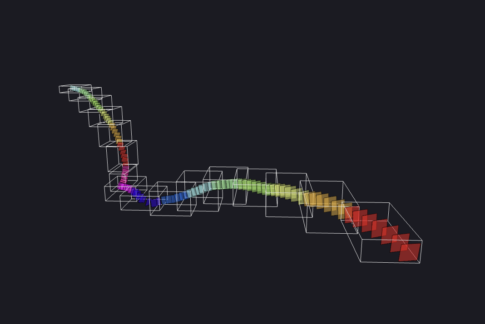

# Slicing



Slicing is one of the primary features of Ouroboros, available in the CLI and the desktop app.

### Using the Slice Page

**Basic Usage Demo**


**Reusing Options from a Previous Run**


### Slicing Options

📁 - Drag and drop files from File Explorer panel into this option.

- 📁 `Neuroglancer JSON` - Path to the Neuroglancer configuration JSON file (exported from Neuroglancer with `{}` icon, or through the Neuroglancer Plugin)
- `Neuroglancer Image Layer` - Select Neuroglancer image layer to slice from.
- `Neuroglancer Annotation Layer` - Select Neuroglancer annotation layer to slice from.
- `Slice Width` - The output width of each slice image.
- `Slice Height` - The output height of each slice image.
- 📁 `Output File Folder` - The folder to save all the resulting files into.
- `Output File Name` - Base name for all output files.
- `Annotation MIP Level` - The annotation layer's MIP level. 0 is the highest resolution.
- `Output MIP Level` - The MIP level to output slices in (essentially a downsample option). 1 is a good starting point.
- `Slicing Parameters`
    - `Distance Between Slices` - The distance between each slice along the annotation path.
    - `Use Adaptive Slicing` - Rather than just using equidistant slices, add more slices in more curved areas.
    - `Adaptive Slicing Ratio` - 1 indicates to consider distance and curvature equally, 0.5 is biased towards distance, and 2 is biased towards curvature.
- `Output Single File` - Whether to output one tiff stack file or a folder of files.
- `Performance Logging` - Choose **Off** (the default) for no performance report, **Standard** to save performance reports and per-step statistics without monitoring RAM, or **Detailed (with RAM)** to save the full report including RAM measurements. RAM monitoring adds overhead. Progress bars and basic step timings remain available in all three modes. The choice is saved as `logging_mode` with your options. Older `reporting_enabled` values load as Off for `false` and Detailed for `true`; an explicit `logging_mode` takes precedence, and missing settings reset to Off. The saved preference applies to desktop runs; CLI runs select their mode with `--logging-mode off|standard|detailed`, defaulting to Off independently of the saved preference.
- `Bounding Box Parameters`
    - `Max Depth` - Limits how many times a bounding box can be subdivided. Reaching this limit can leave a large task.
    - `Target Slices Per Box` - Sets the slice-count target for the reference partition used to limit cumulative requested volume. The slicing partitioner seeks smaller task payloads within that allowance; this value is not a hard slice-count or RAM limit. Lowering it does not guarantee lower peak memory. See [Bounding box partitioning](../reference/bounding-box-partitioning.md).

### How Does Slicing Work?

**Spline Fitting**

Ouroboros fits a spline curve to the annotation path from the Neuroglancer JSON file. This produces a smooth, differentiable curve along the length of the annotations. 

If the line segments between annotation points were used, then there would could be highly discontinuous slice transitions around sharp corners.

**Slice Coordinate Frames**

Ouroboros calculates equidistant points along the spline curve. Each point is "1" apart from the previous to match the appearance of isotropic slices taken from one of the axes of the coordinate space of the full volume (the coordinate space of the annotation points).

To follow any possible path, each point must have its own coordinate frame normal to the spline. For easier segmentation, it is also important that the axes of the point coordinate frames don't flip between points. 

To achieve this, Ouroboros [calculates rotation-minimizing frames](https://github.com/We-Gold/ouroboros/blob/05bac7b1a0a45d6c93e70cc3220397ebc7e11f8b/python/ouroboros/helpers/spline.py#L96) based on the change in orientation of the tangent vectors of adjacent points.

**Rectangles and Grids**

Ouroboros calculates the corners of the slice rectangle at using each point and its associated coordinate axes (as vectors).

_Pseudocode_

```python
width_vector # 'u' unit vector scaled to slice width / 2 
height_vector # 'v' unit vector scaled to slice height / 2

top_left = point - width_vector + height_vector
top_right = point + width_vector + height_vector
bottom_right = point + width_vector - height_vector
bottom_left = point - width_vector - height_vector
```

Then, for each point, a 2D grid is generated with given dimensions (slice width and height). Each point in the 2D grid is a 3D point which is calculated by interpolating between the four corner points.

**Volumes and Cubic Interpolation**

At this point, Ouroboros has a full grid of 3D points associated with each slice, but has yet to download any data from the cloud-hosted volume.

Ouroboros groups slices into bounding boxes, using the full rectangle corners to keep every slice inside its assigned volume. It evaluates several spatial and path-order splits to reduce the largest estimated slicing-task payload. The selected partition requests no more cumulative volume than the reference partition made with the same bounding-box options. Geometry and subdivision limits can prevent further improvement; the partitioner does not measure available RAM or guarantee that a run will fit in memory. [Bounding box partitioning](../reference/bounding-box-partitioning.md) describes the cost model and stopping rules.

Ouroboros downloads each bounding box from the integer voxel at `floor(min)` through `ceil(max)`, inclusive on every axis. Slice coordinates and backprojection use this same integer origin. Regions outside the source volume remain zero-filled.

For each volume, `scipy.ndimage.map_coordinates` extracts values at the slice grid coordinates using cubic interpolation with its default prefilter. Changing bounding boxes can change the prefilter's boundary effects and float32 coordinate rounding. The filtering effect decays with distance but has no fixed voxel-distance cutoff; no extra padding is downloaded to reduce it.

Each of these slices are saved as local tiff images and are later combined into a single output tiff.
