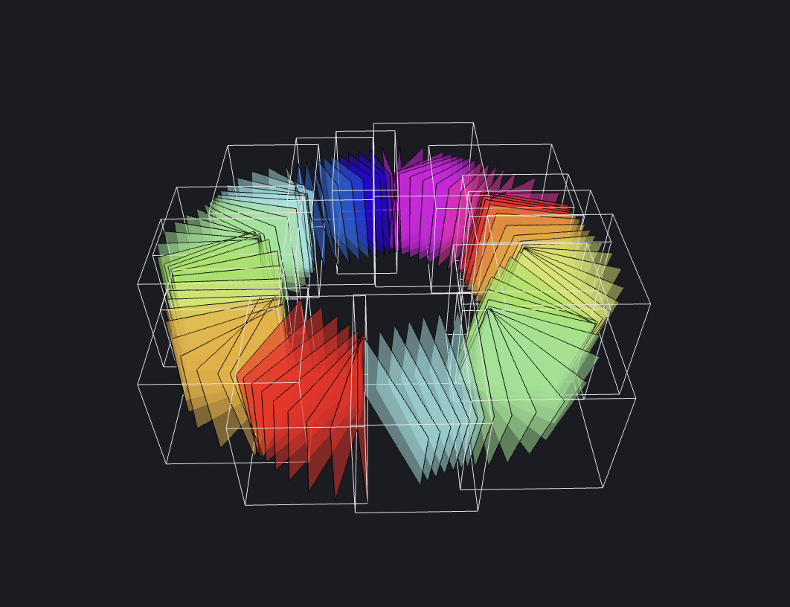

# Ouroboros

`or-uh-bore-us`

Extract ROIs from cloud-hosted medical scans.

Ouroboros is a desktop app (built with Electron) and a Python package (with a CLI). 

The desktop app uses Docker to build and run its Python server. For this reason, **Docker is required** to run Ouroboros.

If you are interested in using the Python package for its CLI or for a custom usecase, check out the [python](https://github.com/ChengLabResearch/ouroboros/tree/main/python) folder in the main repository.

Ouroboros also has a [Plugin System](./guide/plugins.md). Plugin servers are also run in Docker.

## Ouroboros Explanation

A user of Ouroboros may have a multi-terabyte volumetric scan, hosted with the Neuroglancer family of tools (i.e. [cloud-volume](https://github.com/seung-lab/cloud-volume)). 

Perhaps there is a long, relatively sparse structure (ROI), like a nerve or a blood vessel that crosses the entire scan. Even with a well-equipped computer, it would be difficult to segment the entire stucture in one pass due to RAM limitations.

Ouroboros provides a solution. A user first traces the structure in Neuroglancer with sequential annotation points, and then saves the JSON configuration to a file.

Ouroboros opens this configuration file and cuts rectangular slices along the annotation path, producing a straightened volume with the ROI at the center of each slice (usually much smaller than the original scan).

_Every tenth slice in a circular annotation path, rendered in Ouroboros's Slicing Page._

From there, the user segments the much smaller straightened volume with their choice of segmentation system. Then, Ouroboros [backprojects](./guide/backproject.md) the segmented slices into the original volume space (unstraightens it), producing a full segmentation.

## Usage Guide

_It is recommended that you read these pages in order._

- [Download and Install Ouroboros](./guide/downloading.md)
- [Slicing](./guide/slicing.md)
- [Backprojection](./guide/backproject.md)
- [File Explorer](./guide/file-explorer.md)
- [Plugins](./guide/plugins.md)

## Reference

- [Technical Constants](./reference/technical-constants.md) - hardcoded
  limits, defaults, and worker allocation.
- [Bounding Box Partitioning](./reference/bounding-box-partitioning.md) - how
  slices are grouped into source-volume requests.
- [Pipeline Run Statistics](./reference/run-statistics.md) - logging modes and
  performance report contents.

## Releases

Release notes and downloads are on the [Releases](https://github.com/ChengLabResearch/ouroboros/releases) page.
